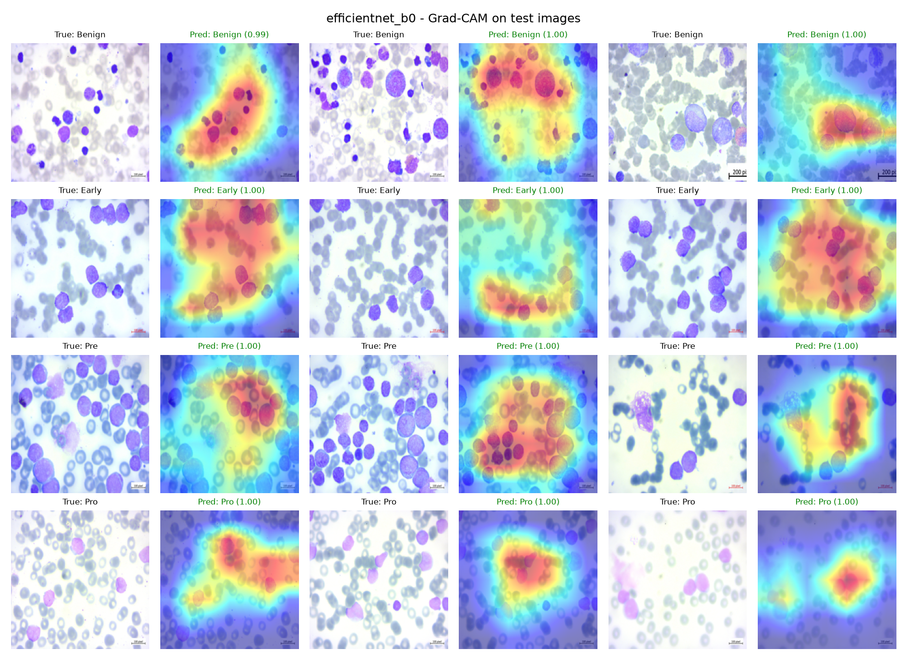
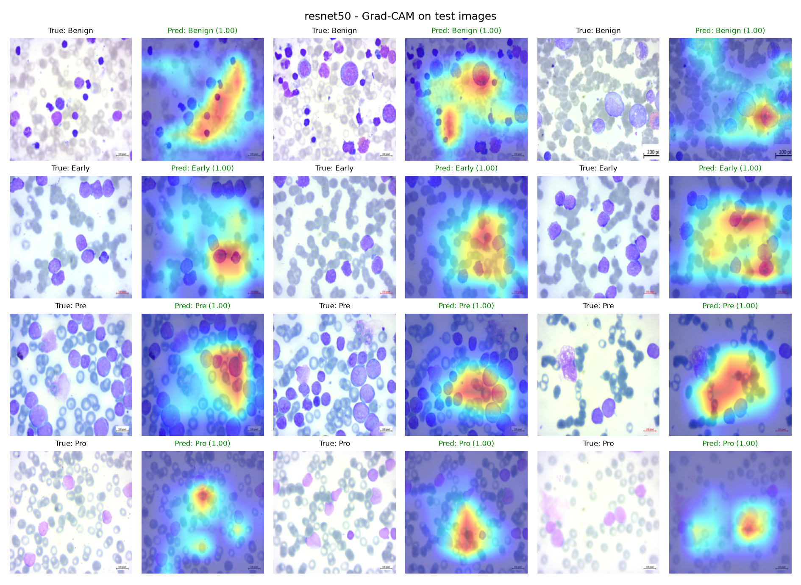
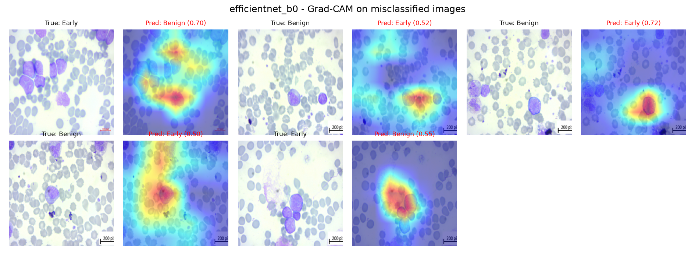

# Blood Cancer Detection Using Machine Learning

**Capstone Project (CSIT-650), Project 1**

An AI-based system that analyses microscopic blood cell images, classifies them into four classes (Benign, Early Pre-B, Pre-B, Pro-B), and explains its predictions with Grad-CAM heatmaps. A Streamlit web app lets a user upload an image and see the prediction, class probabilities, and heatmap.

> **Disclaimer:** This project is for **academic and research purposes only**. It is **not** a medical diagnosis tool and must never replace evaluation by a qualified professional.

[]()

**Live demo:** [YOUR-APP-LINK](https://blood-cancer-detection-vqwhgjgbdn7syyuwappcchj.streamlit.app/)
**Source code:** [github.com/mr-vishalkpal/blood-cancer-detection](https://github.com/mr-vishalkpal/blood-cancer-detection)

---

## Table of contents

1. [Overview](#overview)
2. [Dataset](#dataset)
3. [Methodology](#methodology)
4. [Results](#results)
5. [Explainability (Grad-CAM)](#explainability-grad-cam)
6. [Web application](#web-application)
7. [Project structure](#project-structure)
8. [How to run](#how-to-run)
9. [Limitations](#limitations)
10. [Future work](#future-work)
11. [Team and guide](#team-and-guide)

---

## Overview

The project covers the full machine learning pipeline:

- Dataset preparation with duplicate removal and a leak-free, stratified train/val/test split
- A baseline CNN trained from scratch
- Two transfer-learning models (ResNet50, EfficientNet-B0)
- Evaluation with medical-style metrics (sensitivity, specificity), ROC-AUC, confusion matrices, and bootstrap confidence intervals
- Grad-CAM explainability
- A Streamlit interface for uploading images and viewing results

## Dataset

- **Source:** *Blood Cells Cancer [ALL]* dataset from Kaggle. <!-- TODO: add the Kaggle link and license here -->
- **Classes:** `Benign`, `Early` (Early Pre-B), `Pre` (Pre-B), `Pro` (Pro-B)
- **Images:** 3,222 found, **40 exact duplicates removed**, **3,182 used**
- Only the **original** images were used (not the segmented copies), to avoid leakage.

| Class | Train | Val | Test | Total |
|---|---|---|---|---|
| Benign | 358 | 77 | 77 | 512 |
| Early | 685 | 147 | 147 | 979 |
| Pre | 655 | 140 | 140 | 935 |
| Pro | 529 | 113 | 114 | 756 |
| **Total** | **2,227** | **477** | **478** | **3,182** |

The split is **70% / 15% / 15%**, stratified by class, with a fixed seed (42). It is saved to `data/processed/splits.csv`, so every run and every team member uses the identical split.

## Methodology

**Preprocessing**
- Resize to 224 x 224, normalise with ImageNet mean and standard deviation.
- Augmentation on **training images only**: horizontal and vertical flips, rotation up to 20 degrees, brightness/contrast/saturation jitter.
- Validation and test images are never augmented.

**Models**

| Model | Type | Parameters | Learning rate | Max epochs |
|---|---|---|---|---|
| `simple_cnn` | 4-block CNN trained from scratch (baseline) | 0.39M | 1e-3 | 30 |
| `efficientnet_b0` | ImageNet-pretrained, fine-tuned | 4.01M | 1e-4 | 25 |
| `resnet50` | ImageNet-pretrained, fine-tuned | 23.52M | 1e-4 | 25 |

**Training setup (all models)**
- Loss: cross-entropy with class weights (handles the Benign class being smaller)
- Optimiser: Adam, with `ReduceLROnPlateau` on validation macro-F1
- Best checkpoint chosen by **validation macro-F1**; early stopping with patience 8
- Batch size 32, seed 42
- Trained on Google Colab (Tesla T4 GPU)
- The **test set was used only once**, for the final evaluation

## Results

All numbers are on the held-out **test split (478 images)**.

| Model | Accuracy | Macro-F1 | Macro AUC | Sensitivity (cancer) | Specificity (benign) | Errors |
|---|---|---|---|---|---|---|
| simple_cnn | 99.37% | 0.9926 | 0.9999 | 0.995 | 0.987 | 3 / 478 |
| efficientnet_b0 | 98.95% | 0.9876 | 0.9999 | 0.995 | 0.961 | 5 / 478 |
| resnet50 | 100.00% | 1.0000 | 1.0000 | 1.000 | 1.000 | 0 / 478 |

*Sensitivity and specificity treat Benign as negative and any of Early/Pre/Pro as positive.*

**95% confidence intervals (bootstrap, 2,000 resamples)**

| Model | Accuracy | 95% CI | Macro-F1 | 95% CI |
|---|---|---|---|---|
| simple_cnn | 0.9937 | 0.9854 - 1.0000 | 0.9926 | 0.9825 - 1.0000 |
| efficientnet_b0 | 0.9895 | 0.9791 - 0.9979 | 0.9876 | 0.9758 - 0.9975 |
| resnet50 | 1.0000 | not informative* | 1.0000 | not informative* |

\*With zero errors, every bootstrap resample also has zero errors. Using the rule of three, the 95% upper bound on ResNet50's true error rate is about 3/478 = 0.63%.

**Key findings**
- All three models perform very well. The confidence intervals overlap, so the differences are **not statistically significant** on this test set, and no model should be declared the winner.
- **Every error was between Benign and Early.** Pre and Pro were classified perfectly by all models, so Benign vs Early is the hardest boundary.
- EfficientNet-B0 reached 1.000 validation macro-F1 but 0.9876 on the test set, which shows why a separate, untouched test set matters.
- The small baseline CNN is competitive with much larger pretrained models on this dataset.

Result files are in `results/` (confusion matrices, ROC curves, `model_comparison.csv`, training histories, lists of misclassified images).

## Explainability (Grad-CAM)

Grad-CAM highlights the image regions that most influenced a prediction (red/yellow = high influence).

| EfficientNet-B0 | ResNet50 |
|---|---|
|  |  |

Misclassified test images (EfficientNet-B0):



**Observations:** <!-- TODO: after viewing the heatmaps, write 2-3 sentences. Is the heat on the cell/nucleus or on the background? Do the errors show a different pattern? -->

Grad-CAM is a visual sanity check. It does not prove that the model reasons like a clinician.

## Web application

The Streamlit app (`app/app.py`) lets a user:

- Choose a trained model
- Upload a blood cell image
- See the predicted class and confidence, a probability bar chart, and the Grad-CAM heatmap
- Get a warning when confidence is below 80%

<!-- TODO: add screenshots, e.g.  -->

**Out-of-distribution test:** a non-blood image (a profile photo) was predicted as *Benign* with only 49.2% confidence, which triggered the low-confidence warning. This is one example and does not show that the app reliably rejects non-blood images (see Limitations).

## Project structure

```
blood-cancer-detection/
├── app/
│   └── app.py              # Streamlit interface
├── src/
│   ├── split_data.py       # duplicate removal + stratified split
│   ├── dataset.py          # transforms, Dataset, DataLoaders, class weights
│   ├── model.py            # SimpleCNN, ResNet50, EfficientNet-B0
│   ├── train.py            # training with early stopping
│   ├── evaluate.py         # test metrics, confusion matrix, ROC
│   ├── gradcam.py          # Grad-CAM figures
│   ├── bootstrap_ci.py     # bootstrap confidence intervals
│   └── check_pipeline.py   # sanity check of the data pipeline
├── data/                   # not in Git (raw/ and processed/)
├── models/                 # trained weights (*.pth, not in Git)
├── results/                # plots and metric files
├── requirements.txt
└── README.md
```

## How to run

**Requirements:** Python 3.10 - 3.12. A GPU is recommended for training (we used Google Colab), but not needed for evaluation or the app.

**1. Set up the environment**

```bash
git clone <your-repo-url>
cd blood-cancer-detection
python -m venv venv

# Windows
venv\Scripts\activate
# Mac/Linux
source venv/bin/activate

pip install -r requirements.txt
```

**2. Get the dataset**

Download *Blood Cells Cancer [ALL]* from Kaggle and extract the **original** class folders so that you have:

```
data/raw/Benign/
data/raw/Early/
data/raw/Pre/
data/raw/Pro/
```

**3. Create the split**

```bash
python src/split_data.py
```

**4. Train** (run from the project root; Colab GPU recommended)

```bash
python src/train.py --model simple_cnn --epochs 30 --lr 1e-3
python src/train.py --model efficientnet_b0 --epochs 25 --lr 1e-4
python src/train.py --model resnet50 --epochs 25 --lr 1e-4
```

Weights are saved to `models/<name>_best.pth` and histories to `results/<name>_history.csv`.

> The trained `.pth` files are not stored in this repository because of their size. <!-- TODO: add a Google Drive / release link if you want others to download them. -->

**5. Evaluate and explain**

```bash
python src/evaluate.py
python src/bootstrap_ci.py
python src/gradcam.py --model efficientnet_b0
python src/gradcam.py --model resnet50
```

**6. Launch the app**

```bash
streamlit run app/app.py
```

If the `streamlit` command fails on Windows, use `python -m streamlit run app/app.py`.

## Limitations

- **No patient IDs.** The dataset does not identify patients, so images from the same patient may appear in more than one split. This can make results look better than they would be on new patients.
- **Single dataset.** All results come from one dataset. Performance on images from other labs, stains, or microscopes is unknown and likely lower. No external validation has been done yet.
- **Closed-set classifier.** The model must assign every image to one of four classes, even non-blood images. A confidence threshold only partly mitigates this and is not a reliable out-of-distribution detector.
- **Near-ceiling test results.** With 0 to 5 errors in 478 images, the test set cannot separate the models. The test set is also small.
- **Not clinically validated.** The system is a research prototype. Grad-CAM is a visual aid, not evidence of clinical reasoning.

## Future work

- Patient-level splitting on a dataset that provides patient IDs
- External validation on a second dataset (for example C-NMC 2019 or ALL-IDB)
- Training on multiple datasets to improve robustness to staining and imaging differences
- Out-of-distribution detection to reject non-blood images
- Docker packaging and cloud deployment of the app

## Team and guide

| Name | ID |
|---|---|
| Vishal Kumar pal | 23BTCSE018 |
| 

**Under the guidance of:** Dr. Rishabh Chaudhary

*Capstone Project (CSIT-650)*